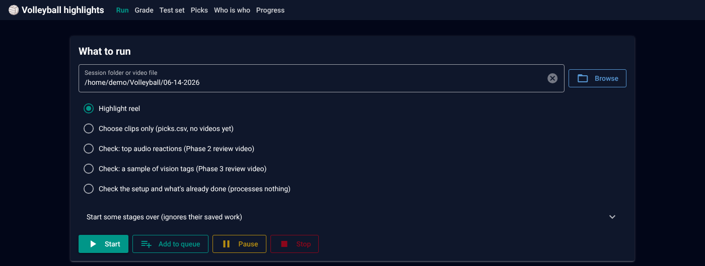

# Volleyball highlights

Turns a day of casual volleyball footage into highlight videos, entirely on
your PC: a ~20 minute highlight reel, long rallies and big spikes first, with
the most unhinged things people said, plus a clip of every play someone said
"clip that" about. Built so far: **Phase 1** (ingest + renderer), **Phase 2** (audio
reaction signals), **Phase 3** (motion filter + vision tagging),
**Phase 4** (scoring every moment, picking and rendering the reel),
**Phase 4b** (a library that learns your group's taste across sessions) and
**Phase 5** (Minecraft-style nametags you name yourself, and an app that
runs it all from your browser), plus two more ways it learns your taste: an
example memory for the vision model and auto-tuned settings.

For a plain-language tour of how it all works, including the AI parts, see
[How the highlights tool works](docs/How%20the%20highlights%20tool%20works.pdf).

## Setup (Windows, NVIDIA GPU)

Run these in PowerShell inside this folder.

```powershell
winget install Python.Python.3.11
winget install Gyan.FFmpeg            # then open a NEW terminal so ffmpeg is on PATH
ffmpeg -hide_banner -encoders | findstr nvenc   # should list h264_nvenc

py -3.11 -m venv .venv
.venv\Scripts\activate
pip install torch torchvision --index-url https://download.pytorch.org/whl/cu128
pip install -r requirements.txt
python -c "import torch; print(torch.cuda.is_available())"   # should print True

winget install Ollama.Ollama          # the local vision model runs in Ollama
ollama pull qwen3-vl:8b-instruct      # about 6 GB; use qwen3-vl:4b-instruct on 8 GB cards

copy config.example.yaml config.yaml  # your own settings; config.yaml stays out of git
```

Put your friends' names in `players:` in your `config.yaml` (see **Names** below).
Without a `config.yaml` the tool runs on `config.example.yaml` as is.

The first audio run downloads the Whisper model (about 1.6 GB) and the PANNs
model (about 330 MB); the first reel with nametags downloads the YOLO player
tracker into `models\` (about 20 MB), and the first vision run downloads the
SigLIP picture model for the example memory into `models\` (about 800 MB).
All are cached, so later runs are offline.

**Check the setup** before a long run, or whenever something seems off. It
processes nothing:

```powershell
python make_highlights.py --check "D:\Volleyball\06-14-2026"
```

It checks Python, ffmpeg and the GPU video encoder, that PyTorch and Whisper
can use the graphics card, the packages, that Ollama is running with the
vision model and that the model answers a test picture from GPU memory, which
models are downloaded already, and free disk space. With a session folder it
also lists each video and which steps are done, still to do, or will be
redone because a setting changed. Leave the folder out to check only the
setup. Each line is marked ✓ fine, ! worth a look, or ✗ needs fixing (with
the fix underneath).

## Make the highlights

Point it at the folder holding one session's videos (or at one video):

```powershell
python make_highlights.py "D:\Volleyball\06-14-2026"
```

Every video in the folder is put in recording order using the time in the
DJI file names, and laid out on one session clock. Files the camera split
from one long recording are joined, so a rally across the split stays one
clip; real breaks between games stay breaks. Each file is analysed once and
cached in `work\<file name>\`, so adding a file later only processes that file.

**Several dates in a row:** give it more than one folder and they run one
after another, each as its own session with its own videos, picks, nametags
and grades. If one fails, the others still run, and the last line says which
failed. Ctrl+C stops the whole queue.

```powershell
python make_highlights.py "D:\Volleyball\06-14-2026" "D:\Volleyball\06-21-2026"
```

Results land in `output\06-14-2026\`:

- `06-14-2026 highlights.mp4`: the best moments of the whole session, in game
  order, aiming for 20 minutes (`reel:` in config.yaml). Long rallies and big
  spikes count most (`fuse.weights`). A rally or great play shows the whole
  rally, from the serve through the celebration, stopping before the next
  serve (`fuse.whole_rally_labels`). Unhinged comments get a place too (see
  below).
  Between clips it mixes dips to black, dissolves and the occasional swipe
  (`render.transitions`).
- `06-14-2026 highlights - timestamps.txt`: what happens when in the reel, one
  line per clip, like `1:00 - 2:00  Long rally #1` or `5:00 - 5:35  Convo #1`.
  A play is named a big spike when someone hits hard, else a long rally when
  the rally runs `fuse.rally_long_s` or more; then great plays, bloopers,
  celebrations, conversations and unhinged comments (with what was said).
- Unhinged comments: Qwen also reads the transcript and rates how unhinged
  each thing people said is (0-10). A "whaaat?!", "bro what" or laughter right
  after a line makes it count more (`comments.cues`). Comments at 5 or more
  get a place in the reel, from just before the comment to just after the
  reaction, up to 30% of the reel (`comments:`). They're all listed, most
  unhinged first, in `work\06-14-2026\comments.csv`.
- `06-14-2026 clip that 1.mp4`, `... clip that 2.mp4`, ...: whenever someone
  says "clip that" (or "clip it", "someone clip that"), the play they mean,
  through to the words (`clip_that:`). That play also counts more for the reel.
- Themed 30-60 s shorts (top plays, bloopers, ...) are off: `shorts.enabled:
  true` brings them back, and `vertical.shorts: both` their 9:16 versions.
- `picks.csv` + `thumbs\`: every clip in every video, with a still of each.

**Swap out a clip:** open `picks.csv`, set `keep` to `n` on its row, save,
and run the same command again. That clip leaves that video and the next best
moment takes its place (clips already encoded are reused, so it's quick).
Change `clip_start_s` / `clip_end_s` on a row (seconds on the session clock)
to trim a clip. Add `--pick-only` to write `picks.csv` without rendering, so
you can check the picks first.

**Names:** the tool never recognises anyone by shirt colour (shirts change
every week). The `players` list in config.yaml is just the names the Who is
who screen offers as you type. To offer a different list for one day, drop a
`session.yaml` into the session folder:

```yaml
players: [Alex, Sam, Jordan]
```

A 3-4 hour session takes a while (vision tagging is the slow part), so it
suits an overnight run. Ctrl+C is safe at any point; run the same command
again to pick up where it stopped.

## The app

Everything above also works from your browser, on this PC only:

```powershell
python make_highlights.py --gui
```



It opens http://localhost:8765 with a screen for each job (links along the top):

- **Run**: pick a session folder (Browse, or one of the recent ones), choose
  what to make (the reel, picks only, the Phase 2/3 checks, or the
  setup check), tick
  any stages to start over, and press Start. Each stage shows a progress bar
  with the time left, plus the same coloured log as the terminal. **Stop** is
  the same as Ctrl+C: everything finished so far is saved. The run keeps going
  if you close the page. When it's done, the videos are linked right there.
  **Add to queue** lines up more folders, each with the options ticked when
  you added it (in Browse, **Queue all** adds every date folder in a folder).
  They run one after another; a date that fails is noted and the next one
  starts, and Stop puts the rest on hold until you press **Start the queue**.
  Every run's log is saved in `work\<session>\logs\`. **Your sessions** lists
  each date with its videos and buttons for its Picks, Who is who (how many
  people are named) and Grade (how many you've graded): each date keeps its own.
- **Grade** and **Test set**: the grading screens from "Teach it your taste".
  Grade has a session picker: one date at a time, or all of them.
- **Picks**: every clip in every video with its thumbnail. Click a thumbnail
  to watch and trim it, switch a clip Out to replace it with the next best
  moment, drag clips (or use the arrows) to change the order, then **Save and
  make the videos**. It edits the same `picks.csv` (close it in Excel first).
- **Who is who**: type a name for each person outlined in the reel's opening (below).
- **Progress**: every ranker version, its score against the config weights,
  your label counts, and buttons to retrain or switch version; below that,
  the tuned settings, whether the example memory is on yet, and how close
  the library is to fine-tuning Qwen (with the latest model checks and a
  button to write the training set).

Stop the app with Ctrl+C in the terminal.

## Nametags

**Nametags.** For the first 18 seconds of the reel, each player gets a
Minecraft-style name tag that follows them: white blocky letters on a
see-through dark box, above their head, or below their feet when above is
off the picture, against bright sky or on top of another tag. You choose the
names:

1. After a run, the log says how many people in those clips have no name yet.
2. Open the app's **Who is who** screen: a still of each tagged clip with
   everyone in it outlined and numbered, and a name box for each beside it
   (names fill in as you type; Tab accepts, Enter goes to the next box). Leave
   a box empty for no tag. Only people on screen while the tags are up are
   listed. People who walk in after the still are listed below it with a
   close-up and when they show up. Someone the camera lost for a moment and
   found again (same place and size, looking the same as a person you named
   in that clip) gets that name by itself, under **Followed automatically**,
   where you can change it.
3. Press **Make the videos again with these names** (only the tagged clips
   are re-encoded).

Nobody is named by guessing: only the names you type, and people followed
from them, get a tag. Turn tags off with `nametags.enabled: false`, or add
them to the shorts too with `nametags.shorts: true`.

**Vertical shorts (off for now).** With `shorts.enabled: true` and
`vertical.shorts: both`, each short is also made as a 9:16 video for phones
(`... bloopers 1 (vertical).mp4`). A 9:16 window follows the players who are
moving (and the ball, when it's seen), panning smoothly like a calm camera
operator. It's a straight crop of the 4K frame with nothing resized: 1216x2160
at `vertical.zoom: 1`. A higher zoom gets closer but keeps fewer pixels
(676x1200 at 1.8); `vertical.resize: true` resizes to `vertical.width` x
`vertical.height` instead. `vertical.shorts: vertical` makes only the phone
version, `landscape` only the wide one.

## Teach it your taste (optional)

Every run adds its moments to `library\` (kept across sessions; `--force`
never touches it), and a small ranker retrains at the end of each run. It
learns from what you already do:

- a clip you cut in `picks.csv` counts as "not a highlight";
- a clip you trimmed counts as "worth showing";
- once you've edited `picks.csv`, the clips you left in count as a weak "yes".

Grading is optional and makes it learn faster. It opens in your browser:

```powershell
python make_highlights.py --grade
```

It shows about 10 moments per session that the tool is least sure about,
looping each one over the clip plus the whole window Qwen looked at for it
(the bar under the video shows Qwen's window in blue, with a tick for each
frame it got, and the clip in teal; click the bar to jump). Keys: **Y** worth
showing, **F** funny, **N** not worth showing (left out of every video from
then on), **1-7** fix the label, **Left/Right** move the clip's start,
**Shift+Left/Right** move its end, **Space** replay, **W** all Qwen looked at
or just the clip, **S** skip, **Backspace** undo. Answers save instantly;
stop it with Ctrl+C in the terminal.

**The test set** is the one grading job worth doing once: about 100 random
moments that are never trained on, used to check every new ranker version.

```powershell
python make_highlights.py --grade test
```

A new ranker version is only used if it beats the current scoring on the test
set (until the test set has 20 moments, it must beat the config weights on
your other labels instead). It starts learning at 30 moments with labels from
you, and its share of the score grows until it fully replaces the config
weights at 300.

- `python make_highlights.py --learn` retrains now and lists every version.
- `python make_highlights.py --use-ranker v2` switches version;
  `--use-ranker off` goes back to the config weights only.

**Example memory** (from about the third game). While Qwen tags a stretch of
footage, it also sees up to 4 moments from earlier games that looked similar,
with what it said about them then and what you said: "first tagged
great_play, excitement 8; the group: not worth showing". So it copies your
group's standards without any retraining. Only moments you graded, cut or
trimmed are used, never the test set. Similar means similar pictures: the
SigLIP model gives every second a fingerprint, with each file's usual look
(court, light, camera angle) taken away so what's left is the action. It
switches on once 20 moments from earlier sessions have labels; the Progress
screen says where it's at. Already-tagged windows keep their answer, so it
only affects new footage (or `--force vlm`).

**Auto-tuned settings** (from about 40 labelled moments). After each run the
tool replays your past games with other settings and keeps whichever puts the
moments you liked above the ones you didn't:

- the scoring weights (`fuse.weights`, `fuse.label_bonus`, `fuse.fun_mix`,
  `fuse.audio_only_factor`);
- each label's clip length (`fuse.clip`), from your trims: if you keep
  starting bloopers 2 s earlier, bloopers start 2 s earlier;
- the reel's cutoff (`reel.min_score`), set so 9 in 10 of the moments you
  liked clear it.

Like the ranker, a new version is only used if it beats the current settings
(on the test set once it has 20 moments, before that on your other labels).
`config.yaml` itself never changes: tuned values are applied on top at the
start of each run, and anything you edit in `config.yaml` afterwards wins.

- `python make_highlights.py --tune` tunes now and lists every version.
- `python make_highlights.py --use-settings v2` switches version;
  `--use-settings off` uses `config.yaml` exactly as written.

**Getting ready to fine-tune Qwen** (Phase 7, from about 500 labelled
moments). Everything you label is also a lesson for Qwen itself, so the tool
keeps what fine-tuning needs: the frames Qwen saw for every window and the
exact prompt it got (`prompt.txt` next to the frames in `library\frames\`).

- `python make_highlights.py --export-training` writes the training set to
  `library\training\<date>\`: every window behind a moment you graded, cut
  or trimmed, with Qwen's answer corrected by what you said (your label;
  excitement raised or lowered for worth showing or not; funny the same).
  Test-set moments are never in it, so the test set stays a fair check.
- `python make_highlights.py --evaluate` checks how well a vision model tags
  your test set (once it has 10 graded moments): the share given the right
  label, and how well its excitement and funny scores put the moments you
  liked first (0.5 = guessing, 1 = perfect). The answers from when the
  footage was tagged are scored too, so you can try another model
  (`--evaluate qwen3-vl:4b qwen3-vl:8b`) or a prompt edit without re-tagging
  a whole session. Every check is saved in `library\evals\`.

The Progress screen shows how close you are, the latest checks, and a
button that writes the training set.

## Phase 1 check: stitch hand-picked moments

Pick five moments you remember and stitch them:

```powershell
python make_highlights.py D:\videos\game.mp4 --at 3:10 12:45 20:02-20:15 31:00 47:30
# python make_highlights.py "D:\Volleyball\06-14-2026\DJI_20260614181558_0007_D.MP4" --at 2:13-2:45 3:06-3:20 3:23-3:36 14:13-15:01 26:01-26:49
# or put them in a file (see picks_example.txt)
python make_highlights.py D:\videos\game.mp4 --picks picks_example.txt
```

A single time like `12:45` becomes a clip from 6 s before to 6 s after
(`render.default_pre_s` / `default_post_s`). Output: `output\game\picks_test.mp4`.
Phase 1 is done when that video plays the right five moments with clean cuts.

## Phase 2 check: are the top reaction peaks real?

```powershell
python make_highlights.py "D:\Volleyball\06-14-2026\DJI_20260614181558_0007_D.MP4"
```

This transcribes the banter, scores every second for laughter, cheering,
shouting, loudness, trigger phrases and bursts of talk, and then renders the
top 20 peaks into one review video, each clip labelled with its rank, game
time and strongest signal.

- `output\game\review_peaks.mp4`: watch this.
- `output\game\review_peaks.csv`: where each clip sits in the review video,
  with a column to mark y/n.
- `work\game\peaks.csv`: top 40 peaks with every signal value and what was said.
- `work\game\transcript.txt`: the whole transcript, timestamped.
- `work\game\timeline.csv`: every signal for every second (open in Excel to
  chart it).

Phase 2 is done when most of the top 20 are real moments.

The plain command now goes all the way to the highlights; add
`--review peaks` to get this check instead.

## Phase 3 check: are the vision labels right?

Needs Ollama running (it sits in the system tray) with the model pulled once:

```powershell
ollama pull qwen3-vl:8b-instruct
python make_highlights.py "C:\path\to\game.MP4" --review tags
```

Audio results are reused, so this goes straight to two new steps:

1. **Motion filter**: measures movement every second and skips 24 s windows
   with almost no movement and no reactions (water breaks, ball chasing).
2. **Vision tagging**: for every remaining window (24 s long, every 16 s),
   Qwen3-VL gets about 25-40 frames (1 per second, plus 4 per second just
   before each laugh or cheer), what was said, what the audio heard, and the
   player list from `config.yaml`. It answers with a label (great_play,
   blooper, celebration, chaos, conversation, rally, downtime), a description, the players
   involved, when the longest rally starts and ends, how big the hardest
   spike is (0-10), excitement and funny scores (0-10), and when the moment
   peaks.

Each window's answer is saved in `work\game\vlm\` as soon as it arrives, so
if you stop the run (Ctrl+C) the next run picks up where it left off.

After vision tagging, a full run has Qwen read the transcript, 30 lines at a
time with what the audio heard after each line, and rate the unhinged comments
(`prompts\rate_comments.txt`). No pictures, so it takes minutes, not an hour;
answers are kept in `work\game\comments.json`.

Then it renders 20 labelled moments, a mix of every label, into one video:

- `output\game\review_tags.mp4`: watch this. Each clip shows its number,
  game time, label and scores.
- `output\game\review_tags.csv`: the model's description and players for
  each clip, with a column to mark whether the label is right.
- `work\game\tags.csv`: every window's labels for the whole game.

Phase 3 is done when most of those 20 labels are right. Qwen describes
players by what they wear (it isn't told anyone's name).

To try it on a few windows first, set `vlm.max_windows: 10` in config.yaml.

## Tuning without code changes

Everything is in `config.yaml`. Raw model outputs are cached in
`work\<game>\`, so changing weights, class groups, keywords or peak spacing
re-scores in seconds without re-running Whisper or PANNs. Useful knobs:

- `audio.weights`: how much each signal counts. If wind gusts are fooling it,
  lower `loudness`; if quiet laughter is being missed, raise `laugh`.
- `audio.panns.classes`: which AudioSet sounds count as laugh / cheer / shout.
- `audio.keywords`: phrases your group actually says after a big moment.
- `audio.peaks.min_separation_s`: how far apart two peaks must be.
- `review.pre_s` / `post_s`: how much of the play before the reaction to show.
- `ingest.audio_filter`: wind cleanup. Changing it re-extracts the audio and
  re-runs both models.
- `prompts\tag_window.txt`: the instructions the vision model gets. Editing it
  (or the player list or any `vlm` setting) re-tags every window on the next run.
  Try an edit with `--evaluate` first: it re-tags only the test set.
- `vlm.frame_width` / `vlm.max_frames`: fewer or smaller frames = faster tagging.
- `motion.idle_fraction`: raise it to skip more quiet stretches.
- `fuse.weights` / `fuse.label_bonus`: what makes a moment score high
  (rally length, spike power, excitement, funny, the group's reaction; auto-tune
  never changes the rally and attack weights). Once auto-tune has a version on,
  it overrides these (and `fuse.clip`, `reel.min_score`) until you edit them
  here; the Progress screen shows what's on.
- `fuse.clip`: seconds before and after the key instant, per label.
- `fuse.whole_rally_labels`, `fuse.celebrate_min_s` / `celebrate_max_s`: which
  labels get the whole rally, and how long the celebration after it may run
  (never into the next serve).
- `reel.target_min`, `reel.min_score`: reel length and quality floor.
- `comments.min_unhinged`, `comments.max_reel_share`: how unhinged a comment
  must be for the reel, and how much of the reel they may take;
  `comments.cues`: the reactions that make a comment count more;
  `prompts\rate_comments.txt`: what Qwen is told an unhinged comment is.
- `shorts.themes`: add, remove or retune short themes (with `shorts.enabled: true`).
- `render.transitions` / `render.transition_s`: how often each transition is
  used, and how long dissolves and swipes take.
- `clip_that.phrases`: what counts as asking for a clip (regular expressions).
- `learning.ranker.min_labels` / `blend_full_at`: when the ranker starts and
  when it fully takes over; `learning.trust`: how much each kind of label counts.
- `learning.examples.count` / `min_similarity`: how many past moments Qwen
  sees per window, and how alike they must look; `learning.examples.enabled:
  false` turns the hints off. `learning.tune.enabled: false` turns auto-tune off.
- `learning.finetune.min_labels`: how many labelled moments the Progress
  screen counts up to before fine-tuning is worth trying.
- `nametags.seconds`, `nametags.text_height`, `nametags.box_opacity`: how long
  the tags stay up, how big they are, how dark the box is. `nametags.font`
  takes any .ttf file if you'd rather use a downloaded pixel font.
- `vertical.zoom`, `vertical.max_pan`, `vertical.dead_zone`: how close the
  phone version gets, how fast it pans, how much movement it ignores.
- `tracking.model`: `yolo11n.pt` is faster, `yolo11m.pt` finds far-away
  players better.

`--force ingest transcript panns motion fingerprints vlm comments` (or `--force all`)
ignores the cache for those stages, for every file of the session.

## Folder layout

```
make_highlights.py      the one command
config.example.yaml     all settings (copy to config.yaml, which git ignores)
pipeline/
  common.py             paths, stage caching, ffmpeg helpers
  config.py             config.yaml schema
  ingest.py             stage 1: 720p proxy + cleaned 16 kHz / 32 kHz audio
  audio.py              stage 2: Whisper, PANNs, loudness -> timeline + peaks
  motion.py             stage 3: movement per second, idle-window filter
  vlm.py                stage 4: Qwen3-VL window tagging via Ollama
  check.py              --check: the setup, and what's done for a session
  session.py            a folder of files -> one ordered session clock
  fuse.py               stage 5: tags + reactions -> scored moments
  clipthat.py           "clip that" in the transcript -> its own clip
  comments.py           Qwen rates the unhinged comments in the transcript
  selection.py          stage 6: pick the reel (+ clip that, shorts), picks.csv, thumbnails
  render.py             stage 7: frame-accurate cuts + concat
  library.py            library\moments.sqlite: moments, labels, versions
  learn/                features, labels, ranker, Grade-screen queue,
                        memory.py (example memory), tune.py (auto-tune),
                        trainset.py (--export-training), evaluate.py (--evaluate)
  polish.py             nametags (+ vertical crop) for each video,
                        and the reel's timestamps list
  track.py              YOLO player tracking (cached per clip)
  nametags.py           who's who, tag placement above/below
  pixelfont.py          the blocky nametag font
  vertical.py           the 9:16 window that follows the action
gui/                    the app (NiceGUI, http://localhost:8765)
  app.py                starts it; shell.py: the top bar shared by every screen
  run.py, grade.py, picks.py, who.py, progress.py   one file per screen
  roadmap.py            the Run screen's Road map of a run's steps
prompts/
  tag_window.txt        what the vision model is asked for each window
  rate_comments.txt     what Qwen is asked about the transcript
work\<file>\            per-file caches (safe to delete; rebuilt on the next run)
work\<session>\         moments.csv: every scored moment of the session;
                        comments.csv: every rated comment, most unhinged first;
                        tags\ (nametag stills), who_is_who.json, order.json;
                        logs\ (the log of every run started in the app)
output\<session>\       videos you watch + picks.csv
library\                 everything learned across sessions (keep it; back it up);
                         training\ (--export-training) and evals\ (--evaluate)
models\                  the YOLO player tracker and the SigLIP picture model
                         (downloaded on first use)
```

## Troubleshooting

- **Not sure what's wrong**: run `python make_highlights.py --check` with the
  same folder. Every ✗ line says what to fix.
- **"ffmpeg not found"**: open a new terminal after installing it, or check
  `where ffmpeg`.
- **Whisper falls back to CPU** (a warning mentioning `cublas64_12.dll` or
  `cudnn`): faster-whisper needs CUDA 12 cuBLAS and cuDNN 9. The script
  borrows them from PyTorch, so first check PyTorch is the GPU build (next
  item; `--check` says so too). If it is and Whisper still can't load them, run
  `pip install nvidia-cublas-cu12 "nvidia-cudnn-cu12==9.*"` and try again.
- **PANNs on CPU, or "PyTorch can't see the GPU"**: the CPU-only build of
  PyTorch got installed (its version ends in `+cpu`). Put the GPU build back:

  ```powershell
  pip uninstall -y torch torchvision
  pip install torch torchvision --index-url https://download.pytorch.org/whl/cu128
  python -c "import torch; print(torch.__version__, torch.cuda.is_available())"
  ```

  The last line should print a version ending in `+cu128`, then `True`.
- **No labels on the review clips**: set `review.font_file` in config.yaml to
  any .ttf file.
- **Quick test on a short clip**: set `audio.whisper.model: small` to make
  the transcript step fast while you check everything works.
- **"the example memory needs transformers"**: run
  `pip install -r requirements.txt` again. Everything else works without it;
  Qwen just gets no hints from earlier games.
- **"player tracking needs Ultralytics"**: run
  `pip install -r requirements.txt` again. Without it, the reel has no tags and
  vertical shorts use a fixed centre crop.
- **A name on the wrong player**: fix it on the Who is who screen, then press
  **Make the videos again with these names**.
- **"Can't reach Ollama"**: start the Ollama app, then run the command again.
- **"Ollama doesn't have qwen3-vl:8b-instruct"**: a run downloads it by itself, or run
  `ollama pull qwen3-vl:8b-instruct`.
- **"didn't answer two windows in a row"**: the log's `[vlm] ... loaded` line says how
  much of Qwen fits on the graphics card. Below 100%, close other programs that use it or
  lower `vlm.num_ctx`. Use an `-instruct` model: plain `qwen3-vl:8b` is the "thinking"
  version, which reasons at length before every answer.
- **Plain text and a `[####----]` bar instead of colours**: the `rich`
  package is missing. Run `pip install rich` inside the .venv.
- **Stopping a run**: Ctrl+C is safe. Finished steps are cached, so running
  the same command again picks up where it stopped.
- **Tagging is slow**: lower `vlm.frame_width` to 512 or `vlm.max_frames` to 24.
